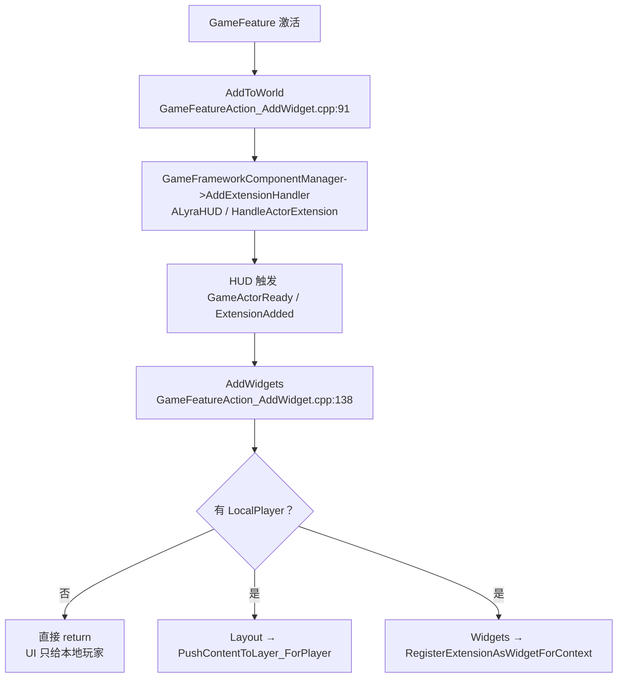
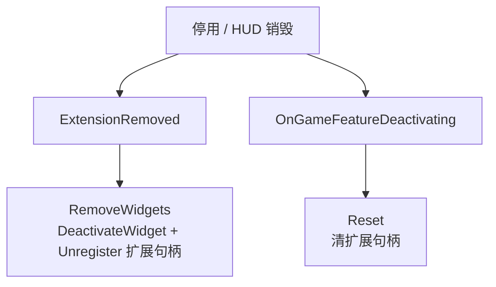

- LyraGameMode.cpp: 将ALyraHUD作为CommonUI 层与 GameFramework的桥接器。
- GameFeatureAction_AddWidget.cpp：把 Layout 推入 UI.Layer.Game 层，并把零散控件注册到 HUD.Slot.* 扩展槽。


# Lyra  UI加载结构
- **Experience**：`B_LyraDefaultExperience`
    - **添加 UI 的 Action**：[[#UGameFeatureAction_AddWidgets]]
        - **Layout**：`PushContentToLayer(UI.Layer.Game, W_DefaultHUDLayout)`
        - **ShooterCore**：`LAS_ShooterGame_StandardHUD`
            - **注册扩展控件**：`RegisterExtensionAsWidget(HUD.Slot.*, W_QuickBar / W_EliminationFeed / ...)`
                - **布局内嵌控件**：`W_ShooterHUDLayout`
                    - `W_Healthbar`
                    - `W_AbilityProgress`
                    - `W_AbilityFailureFeedback`


# ULyraHUDLayout
ULyraHUDLayout -> **ULyraActivatableWidget**。

作为底层Layout容器存在，子类有：
- W_DefaultHUDLayout
- W_FrontEndHUDLayout
- W_ShooterHUDLayout
- W_ShooterReplayLayout
- W_TopDownArenaHUBLayout

## 主要作用：
1. 作为 Experience 注入的 HUD 布局容器：
由 GameFeatureAction_AddWidgets 通过 PushContentToLayer_ForPlayer(UI.Layer.Game, ...) 推入游戏层，承担 HUD 根布局职责（LyraHUDLayout.h:18 注释）。

2. ESC / 暂停菜单
HandleEscapeAction() 响应 Escape 输入动作，把 EscapeMenuClass（`TSoftClassPtr<UCommonActivatableWidget>`）推入菜单层。

3. 手柄断开检测与提示界面
- NativeOnInitialized 里获取 InputDeviceSubsystem 的 DeviceMapper，注册 OnInputDeviceConnectionChange 和 OnInputDevicePairingChange 两个监听（LyraHUDLayout.cpp:46-47），NativeDestruct 里注销。
- 设备连接/配对变化时，NotifyControllerStateChangeForDisconnectScreen() 用 FTSTicker 把处理延迟到下一帧，由 ProcessControllerDevicesHavingChangedForDisconnectScreen() 检查玩家是否已无可用输入设备。
- 若完全断开，DisplayControllerDisconnectedMenu()（BlueprintNativeEvent）把 ControllerDisconnectedScreen 推到 UI.Layer.Menu；恢复后 HideControllerDisconnectedMenu() 隐藏。
- ShouldPlatformDisplayControllerDisconnectScreen() 依据 PlatformRequiresControllerDisconnectScreen 平台标签决定该平台是否启用此界面。

## ULyraActivatableWidget
- ELyraWidgetInputMode InputConfig：控件输入状态枚举。
- EMouseCaptureMode GameMouseCaptureMode：鼠标捕捉枚举。
```c++
TOptional<FUIInputConfig> ULyraActivatableWidget::GetDesiredInputConfig() const
{
	switch (InputConfig)
	{
	case ELyraWidgetInputMode::GameAndMenu:
		return FUIInputConfig(ECommonInputMode::All, GameMouseCaptureMode);
	case ELyraWidgetInputMode::Game:
		return FUIInputConfig(ECommonInputMode::Game, GameMouseCaptureMode);
	case ELyraWidgetInputMode::Menu:
		return FUIInputConfig(ECommonInputMode::Menu, EMouseCaptureMode::NoCapture);
	case ELyraWidgetInputMode::Default:
	default:
		return TOptional<FUIInputConfig>();
	}
}
```

# Lyra UI 数据动态绑定机制

## 1. 消息总线 `UGameplayMessageSubsystem`（主要通道）

| 数据源         | 广播点                                                                             | 消息标签                                                        |
| ----------- | ------------------------------------------------------------------------------- | ----------------------------------------------------------- |
| 快捷栏槽位 / 激活槽 | `ULyraQuickBarComponent::OnRep_Slots` / `OnRep_ActiveSlotIndex`                 | `Lyra.QuickBar.Message.SlotsChanged` / `ActiveIndexChanged` |
| 背包堆叠变化      | `FLyraInventoryList::BroadcastChangeMessage`                                    | `Lyra.Inventory.Message.StackChanged`                       |
| 伤害          | `ULyraHealthSet::PostGameplayEffectExecute`                                     | `Lyra.Damage.Message`                                       |
| 击杀播报        | `ULyraHealthComponent` 死亡处理                                                     | `Lyra.Elimination.Message`                                  |
| 客户端转发       | `ALyraPlayerState::ClientBroadcastMessage` / `LyraVerbMessageReplication` 在本地重播 | 原标签                                                         |

**消费端（蓝图 UI）**
在UMG中通过`AsyncAction_ListenForGameplayMessage`取得数据并进行对应的数据设置。比如：
- `W_EliminationFeed`
- `W_QuickBarSlot`


## 2. C++ 委托绑定
- `ULyraHealthComponent`：OnHealthChanged` / `OnMaxHealthChanged` / `OnDeathStarted` / `OnDeathFinished → `W_Healthbar` 绑定 `OnHealthChanged` 刷新血条。
- `ULyraWeaponUserInterface`：NativeTick 每帧查 `EquipmentManager` 的武器实例，变化时调 `RebuildWidgetFromWeapon` 并触发蓝图事件 `OnWeaponChanged` → `W_WeaponReticleHost` 绑定 `OnWeaponChanged`。
- **ASC 属性变化委托**：`W_QuickBarSlot` 中引用 `Lyra.ShooterGame.Weapon.MagazineAmmo` / `SpareAmmo` 属性（资产字符串确认，未逐节点核对连线）。
- `ULyraBoundActionButton`：监听 `InputMethodChanged` 换按键图标。

## 3. C++ Tick更新
- **IndicatorSystem**：`SActorCanvas` 每帧按 `IndicatorDescriptor` 排布屏幕指示器。
- `ULyraHUDLayout` 监听输入设备连接变化，动态推入断开手柄的提示界面。


#  Lyra UI 动态拼装机制
## UGameFeatureAction_AddWidgets
### 1. 什么时候装配（生命周期）

`UGameFeatureAction_AddWidgets` -> `UGameFeatureAction_WorldActionBase`，配置:

| 数组          | 配置项                       | 用途   |
| ----------- | ------------------------- | ---- |
| `Layout[]`  | `LayoutClass` + `LayerID` | 整层布局 |
| `Widgets[]` | `WidgetClass` + `SlotID`  | 零散控件 |

**激活流程**



**停用 / HUD 销毁**



### 2. Layout 推层（整层 UI）

```text
PushContentToLayer_ForPlayer(LocalPlayer, LayerID, LayoutClass)   // GameFeatureAction_AddWidget.cpp:155
  └─ CommonUIExtensions.cpp:55-74
      └─ GameUIManagerSubsystem → 当前 UGameUIPolicy → GetRootLayout(LocalPlayer)
          └─ UPrimaryGameLayout::PushWidgetToLayerStack(LayerName, WidgetClass)
              └─ GetLayerWidget(LayerName)->AddWidget(...)        // PrimaryGameLayout.h:102-112
```

- `RootLayout` 是 `W_OverallUILayout`，它在蓝图里用 `RegisterLayer` 注册了 4 个 `CommonActivatableWidgetStack`：`UI.Layer.Game` / `GameMenu` / `Menu` / `Modal`。
- 每个 Layer 是一个**激活栈**（`UCommonActivatableWidgetStack`）：新控件压栈并激活，旧控件休眠，处理输入路由和过渡动画。
- 返回的 `UCommonActivatableWidget*` 记到 `LayoutsAdded`，Feature 卸载时 `DeactivateWidget`。

> [!warning] 静默失败
> 层标签不存在时 `GetLayerWidget` 返回 `null`，推入**静默失败**，不会报错。

### 3. 扩展槽（零散控件插槽）

**注册端（C++）**

```text
RegisterExtensionAsWidgetForContext(SlotID, LocalPlayer, WidgetClass, Priority=-1)
  → UUIExtensionSubsystem 里存一条 FUIExtension {
        ExtensionPointTag = SlotID,
        ContextObject     = LocalPlayer,
        Data              = WidgetClass（UClass 本身）
    }
```

**消费端（蓝图控件）**：`UUIExtensionPointWidget`（`UIExtensionPointWidget.cpp`）放在布局里的某个位置，配置 `ExtensionPointTag`，并在 `RebuildWidget` 时调用 `RegisterExtensionPoint` 注册扩展点。

**匹配条件**（`UIExtensionSystem.cpp:35-59`）：

1. **Tag 匹配**：`ExactMatch`，或 `PartialMatch` 时沿 tag 父层级向上找（`NotifyExtensionPointsOfExtension` 遍历 `RequestDirectParent`）。
2. **Context 必须相同**：注册端用 `LocalPlayer`，扩展点也注册了 `ForContext(GetOwningLocalPlayer())`（另外还会在 `PlayerState` 就绪后注册一次 `PlayerState` 上下文）。
3. **Data 类型**：`WidgetClass` 需是 `AllowedDataClasses`（`UUserWidget`）的子类。

命中后回调 `OnAddOrRemoveExtension(Added, Request)`：把 `Data`（`UClass`）实例化成子控件插入扩展点控件，记录 `ExtensionPointHandle → Widget` 映射；`Removed` 时销毁。

> [!tip] 已在资产中验证
> `W_ShooterHUDLayout` 内配置了 `ExtensionPoint_Equipment` / `ExtensionPoint_Reticle` / `ExtensionPoint_ModeStatus` ... 等扩展点，其中出现 `HUD.Slot.EliminationFeed`；注册端是 `LAS_ShooterGame_StandardHUD` 里的 `HUD.Slot.Equipment` / `HUD.Slot.Reticle` / `HUD.Slot.EliminationFeed` / `HUD.Slot.TopAccolades` 等。

### 两者的分工

| | Layout 推层 | Slot 扩展 |
| --- | --- | --- |
| 粒度 | 整个 HUD 布局页 | 布局内的一个插槽 |
| 容器 | `CommonActivatableWidgetStack` 栈 | `UUIExtensionPointWidget` 的子槽 |
| 数量 | 一个层可以有多个 layout 叠栈 | 一个扩展点可挂多个扩展（按 `Priority` 排序） |
| 用途 | 游戏内 HUD / 菜单 / 弹窗整页切换 | 模块化拼接：快捷栏、准星、击杀播报、触屏按钮、性能面板等 |

> [!success] 设计收益
> Experience 和 GameFeature 可以按需组合 UI，Feature 激活就插入、卸载就移除，UI 布局本身不需要知道具体游戏功能。

# CommonActivatableWidgetStack 扫描结果

> [!info] 扫描范围
> `Content/` + `Plugins/` 下全部 `.uasset`（约 170 个 WidgetBlueprint），对二进制名称表做精确类名匹配。

**只有 1 个资产使用 `CommonActivatableWidgetStack`：**

`Content/UI/W_OverallUILayout.uasset`

- 父类是 `UPrimaryGameLayout`，即 `B_LyraUIPolicy` 配置的 `RootLayoutClass`。
- 内含 **4 个** `CommonActivatableWidgetStack` 实例，分别通过 `RegisterLayer` 注册：`UI.Layer.Game`、`UI.Layer.GameMenu`、`UI.Layer.Menu`、`UI.Layer.Modal`（每个层标签在资产中各出现 2 次：控件树 + `RegisterLayer` 节点；类名引用 1 次，4 个实例共享）。
- **误报排除**：`W_WeaponReticleHost.uasset` 里出现 "WidgetStack" 只是控件名 / `WidgetTree` 属性，精确匹配 `CommonActivatableWidgetStack` 为 0。

其余布局（`W_DefaultHUDLayout`、`W_ShooterHUDLayout`、`W_FrontEndHUDLayout` 等）都不内嵌 Stack，而是作为普通 widget 被 push 进 `RootLayout` 的层栈。

# Lyra 弹窗实现

三类弹窗，统一基于 `UCommonActivatableWidget` + CommonUI 层栈。

## 1. 通用确认 / 错误弹窗（主力，Modal 层）

```text
LocalPlayer->GetSubsystem<UCommonMessagingSubsystem>()
  ->ShowConfirmation(Descriptor, ResultCallback)                     // 调用示例 LyraSettingValueDiscrete_Language.cpp:49
    └─ ULyraUIMessaging::ShowConfirmation                            // LyraUIMessaging.cpp:25-36
        └─ RootLayout->PushWidgetToLayerStack<UCommonGameDialog>(
               "UI.Layer.Modal", ConfirmationDialogClass,
               [&](Dialog){ Dialog.SetupDialog(Descriptor, ResultCallback); })
```

- **类层次**：`UCommonGameDialog`（Abstract）→ `ULyraConfirmationScreen` → 蓝图 `W_ConfirmationDefault` / `W_ConfirmationError`（资产字符串验证；配置在 `Config/DefaultGame.ini:79-81`）。
- **`SetupDialog`**（`LyraConfirmationScreen.cpp:19-58`）：
    - 填充 `Text_Title` / `RichText_Description`。
    - 清空 `EntryBox_Buttons`，按 `Descriptor->ButtonActions` 动态创建 `ULyraButtonBase`。
    - 按钮触发键映射：`Confirmed` → 默认点击键，`Declined` → 默认返回键，`Cancelled` → 数据表 `CancelAction`；通过 `SetTriggeringInputAction` 绑定，点击回调绑定 `CloseConfirmationWindow(Result)`。
- **关闭**（`LyraConfirmationScreen.cpp:72-76`）：`DeactivateWidget()` + 执行 `OnResultCallback`；点击遮罩 `Border_TapToCloseZone` 视为 `Declined`。
- **Descriptor 工厂**：`CreateConfirmationOk` / `OkCancel` / `YesNo` / `YesNoCancel`（`CommonGameDialog.cpp:11-89`）。

## 2. 菜单类弹窗（Menu 层 + Escape 输入）

- `ULyraHUDLayout::NativeOnInitialized` 注册 `UI.Action.Escape` 输入动作（`LyraHUDLayout.cpp:39`）。
- 触发 `HandleEscapeAction` → `PushStreamedContentToLayer_ForPlayer(LocalPlayer, "UI.Layer.Menu", EscapeMenuClass)`（`LyraHUDLayout.cpp:67-73`），异步加载后压入 Menu 栈。
- `EscapeMenuClass` 在 HUD Layout 蓝图默认值里指向 `W_LyraGameMenu`；菜单内打开设置时 `W_LyraGameMenu` 通过 `PushContentToLayer` 把 `W_LyraSettingScreen` 推入 `UI.Layer.Modal`（资产字符串验证），关闭用 `DeactivateWidget`。

## 3. 专项交互弹窗（直接占 Modal 层）

- **按键重绑定**：`ULyraSettingsListEntrySetting_KeyboardInput` 直接 `PushContentToLayer_ForPlayer(..., "UI.Layer.Modal", PressAnyKeyPanelClass)`，拿到 `UGameSettingPressAnyKey*` 后绑定回调（`LyraSettingsListEntrySetting_KeyboardInput.cpp:38-59`）。
    - `UGameSettingPressAnyKey` : `UCommonActivatableWidget` 在激活时注册 Slate `InputPreProcessor` 捕获任意键（Esc / 触摸 / 手柄 = 取消），`Dismiss` 延迟一帧后 `DeactivateWidget()` 再广播结果（`GameSettingPressAnyKey.cpp:90-149`）；`UKeyAlreadyBoundWarning` 是它的子类。
- **手柄断开屏**：`ULyraHUDLayout` 监听输入设备连接变化，调用蓝图事件 `DisplayControllerDisconnectedMenu`（C++ NativeEvent）推入 `W_ControllerDisconnected`；隐藏时 `PopContentFromLayer`（`LyraHUDLayout.cpp:175-190`）。

## 关键机制

| 机制 | 说明 |
| --- | --- |
| 模态性 | 由层栈保证：同一层只有栈顶 widget 激活并接收输入，下层休眠；Modal 层独立于 Game / Menu 层 |
| 打开 | 一律 `PushWidgetToLayer(Stack)`，按 Tag 找到对应栈，找不到静默失败 |
| 关闭 | 一律 `DeactivateWidget()` 或 `PopContentFromLayer()`，由栈做过渡和清理，不手动 `RemoveFromParent` |
| 数据 | `UCommonGameDialogDescriptor`（Header / Body / ButtonActions）+ 结果回调 `FCommonMessagingResultDelegate` |
| 输入 | 确认 / 取消按钮通过 `SetTriggeringInputAction` 绑定 Click / Back 键，天然支持手柄与键鼠 |